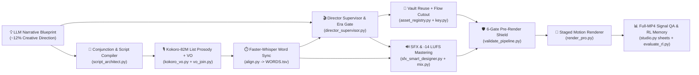

# 🎬 Stickman Hybrid — Machine-First 2D Documentary & Explainer Studio (`v4.0`)

[](#old-version-vs-v40-comparison)
[](https://www.python.org/)
[](https://ffmpeg.org/)
[](https://labs.google/flow)
[](#audio-storytelling--voiceover)
[](#youtube-monetization--copyright-purity-guarantee)

> **A 100% free, local, Machine-First 2D stickman documentary production engine (`9:16` Shorts + `16:9` Long)** featuring word-locked choreography, staged Vox-style motion cards, a 316-asset transparent sticker vault, studio `-14 LUFS` audio mastering, and 6 pre-render Quality Gates.

---

## 🌟 Overview

**Stickman Hybrid (`v4.0`)** turns an approved documentary script into independent, zero-crop **`9:16` Vertical Shorts (`1080×1920`)** and **`16:9` Widescreen Master Documentaries (`1920×1080`)** with expressive 2D stickman art (`look: bright` warm vintage parchment), slow choreographed data graphics, animated WebP/PNG props, tactile Foley sound design, and automated signal QA.

### Machine-First Split (`~88% Local Engine / ~12% LLM`)

Every mechanical, mathematical, DSP, CV, validation, rendering, and QA step executes **100% locally in Python, NumPy, SciPy, Pillow, Kokoro-82M, Faster-Whisper, Tesseract OCR, and FFmpeg**, while the LLM focuses strictly on creative narrative ideation, factual accuracy, and scene prompts:



| Stage | Owner | Modules & Deterministic Capabilities |
| :--- | :--- | :--- |
| **Story, 6-Act Retention & Prompts** | **LLM** + Local Audit | Authored blueprint audited locally by `narrative_intelligence.py`, `curiosity_engine.py`, `viral_hook_engine.py`, and `viral_seo_intelligence.py`. |
| **Text Normalization & Gaps** | **100% Local** | `script_architect.py` normalizes telegraphic comma lists (`"sugar, coffee, soda"` $\to$ `"sugar, coffee, and soda"`) and sets twist/punctuation pauses. |
| **TTS & Enumerated List Prosody** | **100% Local** | `kokoro_vo.py` (`Kokoro-82M`) synthesizes multi-item lists with natural `0.28s–0.42s` breathing rhythm, DC removal, and `12ms` fades; `vo_join.py` levels to `-16 LUFS`. |
| **Forced Word Alignment** | **100% Local** | `align.py` (`Faster-Whisper int8`) locks word timestamps (`WORDS.tsv`) for subtitles, sticker onsets, and `F_RUSHED_LIST` cadence checks. |
| **Asset Search & Flow Keying** | **100% Local** (+ Flow) | `asset_registry.py` + `index_stickers.py` search `316` alpha-verified props with strict **`ban_modern` Era Filtering**; `key.py` + `cutout.py` key magenta backgrounds. |
| **Director Choreography** | **100% Local** | `director_supervisor.py` enforces **Literal + Era-Safe Sticker Logic** (`REJECTED_ERA_MISMATCH`, `REJECTED_NONLITERAL`), shot-size alternation, and `DIRECTOR_PLAN.json` staging. |
| **VFX & Audio Mastering** | **100% Local** | `vfx_smart_designer.py`, `sfx_smart_designer.py`, and `mix.py` apply `zoom_dissolve` / `slide_push` / `paper_crossfade`, trim silent music intros, duck beds, and master to `-14.0 LUFS`. |
| **Validation, Render & Signal QA** | **100% Local** | `validate_pipeline.py` runs 6 Pre-Render Gates (OCR leak `conf >= 65.0`, banned SFX block, Fact-Number Parity, `F_RUSHED_LIST`); `render_pro.py` & `evaluate_rl.py` verify MP4 signals. |

---

## 🔄 Old Version vs. `v4.0` Comparison

| Pillar | Previous Release (`origin/main` `9eb7ac0`) | `v4.0` Machine-First Documentary Engine |
| :--- | :--- | :--- |
| **Architecture Balance** | Monolithic scripts with manual per-scene debugging | **~88% Local Deterministic Engine / ~12% LLM**, unified under `studio.py` & `DIRECTOR_PLAN.json` |
| **Editorial Cards & Motion** | Fast snap-in cards (`~0.25s`), opaque block checklists, single `crossfade` / abrupt wipes | Staged **`easeOutQuart` / `easeInOutCubic`** cards (`draw_scale_compare`, `draw_strike_replace_card`, `card_stat`, `split_compare`, `bar_timeline`, `stat_pie`), **seamless translucent frosted `checklist_build`**, head-clear **`inset_shelf`**, silky **`slide_push` / `zoom_dissolve` / `paper_crossfade`** |
| **Sticker & Visual Vault** | `134` static PNG stickers, `0` curated backgrounds/VFX catalogs, raw filename tag bleed | **`316` alpha-verified cutouts** (`113` Owned-Flow + `203` CC0/MIT + **`5` animated `.webp`**), **`8` CC0 backgrounds**, **`12` VFX overlays** (`3` animated `.webp`), zero category/homograph tag pollution |
| **Sticker Intelligence** | Generic semantic guesses (`lightbulb` / `clock` on prehistoric scenes, occasional face overlap) | **Strict Literal + Era Compatibility Gate** (`REJECTED_ERA_MISMATCH`, `REJECTED_NONLITERAL`), white-head salience clearance, `0` random fill |
| **Audio & Voiceover** | Static SFX/music picks, occasional dead-air music intros (`1.0s–2.2s`), rushed comma lists | **`1,654` audio assets** (`1,582` SFX + `72` music beds), auto-trimmed music onsets (`_detect_music_onset_sec()`), **`twink/bell/chime/scratch` SFX blacklist**, **Kokoro Enumerated List-Prosody pacing**, `-14.0 LUFS` master, standalone `16:9` music-only Outro |
| **Quality Gates & Signal QA** | Basic file existence checks & text RL report | **6-Gate Pre-Render Shield**, Confidence-gated OCR leak check, **Fact-Number Parity**, **`F_RUSHED_LIST`** cadence audit, post-render `hook_sheet` / `phone_sheet` / `beats_sheet`, `F_STUTTER` / `F_FLASH_FRAME` / `ebur128` scan |

---

## 📦 Verified Asset Vault & 9 Synced Skills

All asset manifests are 100% reconciled (`0` missing files, `0` orphan files) and all **9 skills** are mirror-synced (`0 diff` across `skills/`, `~/.gemini/config/skills/`, and `~/.claude/skills/`):

* **Stickers ([stickman-stickers/CATALOG.tsv](skills/stickman-stickers/CATALOG.tsv)):** **`316`** transparent cutouts (`113` `flow_vault` + `203` `cc0_library`, `316/316 alpha_ok=True`, static `.png` + animated `.webp`).
* **SFX & Music ([vox-doc-sound/CATALOG.tsv](skills/vox-doc-sound/CATALOG.tsv)):** **`1,654`** tracks (`1,582` CC0 Foley/Impacts/Tactile UI SFX + `72` music beds with non-silent `0.00s` onsets).
* **Backgrounds ([backgrounds/CATALOG.tsv](skills/stickman-hybrid/backgrounds/CATALOG.tsv)):** **`8`** editorial parchment, vintage grain, kraft, blueprint, and dark-outro textures.
* **VFX Overlays ([vfx_assets/CATALOG.tsv](skills/stickman-hybrid/vfx_assets/CATALOG.tsv)):** **`12`** CC0/MIT lighting, ink-arrow, ban-stamp, and animated paper-grain / sunlit-dust `.webp` layers.
* **Look Presets (`skills/stickman-hybrid/looks/`):** `bright` (canonical warm parchment), `warm`, `night`, `ink`, `oversimplified`, `cgp_grey`, `casually_explained`, `minute_physics`, `painted`.
* **9 Modular Skills (`skills/`):** `stickman-hybrid`, `stickman-stickers`, `vox-doc-sound`, `data-storytelling`, `emotional-arc-designer`, `headline-psychologist`, `loss-aversion-designer`, `visual-emotion-engineer`, `youtube-seo-optimizer`.

---

## 🚀 Quickstart & CLI Reference (`studio.py`)

### 1. Prerequisites & Setup
```bash
# Ubuntu / Debian FFmpeg (with libass + VA-API support)
sudo apt update && sudo apt install -y ffmpeg tesseract-ocr

# Python dependencies (Python 3.11+)
python3 -m pip install -r requirements.txt

# Verify zero-setup environment & catalogs
python3 studio.py doctor
```

### 2. `studio.py` Control Plane Commands

| Command | Purpose |
| :--- | :--- |
| `python3 studio.py doctor` | Audits Python packages, FFmpeg/VA-API, Kokoro, Whisper, fonts, catalogs, RL policy, and 6-Gate shield. |
| `python3 studio.py create "<Topic>" --look bright` | Runs dual-pipeline project generation (`9:16` Short + `16:9` Master Documentary) in `~/StickmanHybrid/`. |
| `python3 studio.py director <project_dir>` | Runs Gate 0 choreography, literal/era sticker filtering, and outputs `DIRECTOR_PLAN.json`. |
| `python3 studio.py gate <project_dir> --format 9:16` | Enforces all 6 Pre-Render Quality Gates (`--format` accepts `9:16` or `16:9`). |
| `python3 studio.py stickers --search "bronze sword"` | Searches the 316-asset transparent sticker vault (or rebuilds `CATALOG.tsv` cleanly). |
| `python3 studio.py hook "<Topic>" --archetype modern_inversion` | Generates a standalone 3-second high-retention A-E-T hook test. |
| `python3 studio.py heading "Chapter 1" --subtitle "14,000 BP"` | Renders an animated chapter title card with Ken Burns drift. |
| `python3 studio.py page "50,000 MILES OF STONE" --pose think` | Generates a signature Ink Explainer plain-paper palate cleanser page. |
| `python3 studio.py sheets <video.mp4> --out qa/` | Extracts `hook_sheet.jpg`, `phone_sheet.jpg`, `beats_sheet.jpg` & signal scan (`blank_frame0`, `flash`, `freeze_2.5s`). |
| `python3 studio.py qc <project_dir>` | Runs post-render multi-rule Quality & RL Memory evaluation (`evaluate_rl.py`). |
| `python3 studio.py trends --niche ancient_engineering` | Researches high-RPM YouTube documentary topics and SEO clusters. |
| `python3 studio.py vfx input.mp4 --effect shake_impact` | Applies standalone signal/camera VFX filters to rendered video. |

---

## 📝 `v4.0` Release Highlights

* **Machine-First Choreography:** Replaced erratic pop-ins and rapid snap-cards with staged `easeOutQuart` / `easeInOutCubic` motion (`draw_scale_compare`, `draw_strike_replace_card`, `card_stat`, `split_compare`, `bar_timeline`, `stat_pie`) and smooth `slide_push` (`0.34s`), `zoom_dissolve` (`0.32s`), and `paper_crossfade` (`0.28s`) transitions.
* **Literal + Era-Safe Sticker Intelligence:** Killed hallucinated/illogical stickers (e.g., electric lightbulbs over prehistoric scenes) across `director_supervisor.py` and `asset_registry.py`, and cleaned all cross-category tag leaks in `stickman-stickers/CATALOG.tsv`.
* **Breathable Enumerated List Prosody:** `script_architect.py` + `kokoro_vo.py` rewrite telegraphic comma lists into natural English (`A, B, and C`) spaced cleanly across `WORDS.tsv`, enforced by the new `F_RUSHED_LIST` check in `validate_pipeline.py` and `evaluate_rl.py`.
* **Fact-Number Parity & Confidence-Gated OCR:** Pre-Render Gates automatically verify displayed card stats match spoken `LINES.tsv` numbers and run Tesseract TSV at `conf >= 65.0` so illustrated crosshatching never triggers false header-leak blocks.
* **Broadcast Audio Purity:** Added 6 verified OpenGameArt `CC0-1.0` beds, trimmed dead-air lead-ins across `CC0_PublicDomain` tracks, added `_detect_music_onset_sec()` in `mix.py`, and blocked blacklisted `twink/bell/chime/scratch` SFX inside both selection and Gate 3 validation.

---

## 📁 Repository Layout (`48` Active Scripts)

```text
stickman-animation/
├── studio.py                           # Unified CLI studio orchestrator & signal QA
├── auto_bootstrap.py                   # Zero-setup package & model self-provisioner
├── requirements.txt                    # Python dependency spec
├── AGENT_START_GUIDE.md / CLAUDE.md    # Orchestration & quality-gate manuals
└── skills/
    ├── stickman-hybrid/                # Core rendering, Director, VFX/SFX, 6-Gate shield & RL engine
    │   ├── looks/                      # 9 editorial look presets (bright.md canonical)
    │   ├── backgrounds/                # 8 indexed CC0 parchment/canvas textures
    │   ├── vfx_assets/                 # 12 indexed CC0/MIT overlays (.png + animated .webp)
    │   └── scripts/                    # render_pro.py, director_supervisor.py, validate_pipeline.py, ...
    ├── stickman-stickers/              # 316-asset transparent sticker vault (flow_vault + cc0_library)
    ├── vox-doc-sound/                  # 1,654-track CC0 SFX/music library, Kokoro TTS, Whisper & -14 LUFS mix
    └── [6 companion writing/SEO skills]# data-storytelling, emotional-arc-designer, headline-psychologist,
                                        # loss-aversion-designer, visual-emotion-engineer, youtube-seo-optimizer
```

---

## 💰 YouTube Monetization & Copyright Purity Guarantee

* **Original Scene Art:** All primary 2D stickman scenes (`shots/`) and Tier-1 cutouts (`flow_vault/`) are original project-generated artwork.
* **CC0 / MIT Prop & VFX Vault:** External icons, animated `.webp` props, music beds, and SFX are strictly verified **CC0-1.0 / Public Domain / MIT** and logged with source URLs across all `CATALOG.tsv` manifests.
* **Open-Weights Voice & Fonts:** Uses Apache 2.0 `Kokoro-82M` (`Faster-Whisper` MIT) and SIL Open Font License fonts (`PermanentMarker`, `Bangers`, `Caveat`, `SedgwickAve`, `PatrickHand`, `Montserrat`, `LuckiestGuy`, `Kalam`).
