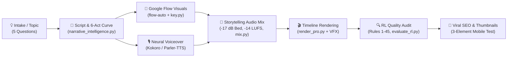

# 🎬 Stickman Hybrid: AI Documentary & Explainer Animation Studio

[](https://www.python.org/)
[-green.svg)](https://ffmpeg.org/)
[](https://labs.google/flow)
[](#-youtube-monetization--copyright-purity-guarantee)
[](LICENSE)

> **The complete, end-to-end autonomous AI studio for viral 2D stickman documentaries, history explainers, and YouTube Shorts.**  
> Inspired by the retention mastery of **Vox, Kurzgesagt, Johnny Harris, and Lemmino**.

---

## 🌟 Overview

**Stickman Hybrid** is a production-grade automated pipeline that generates full-length documentary explainers (16:9 widescreen) and vertical viral shorts (9:16) with hand-drawn stickman illustrations, dynamic cut-out props, tactile Foley sound design, and broadcast-grade audio mixing.

Unlike simplistic AI video generators that output random B-roll, **Stickman Hybrid** enforces a rigorous **6-Act Psychological Retention Tension Curve**, **The Vox Drop-Out Silence beat**, **Kurzgesagt Auditory Highlighter Pens**, **4–7 Second Pattern Interrupts**, and **100% CC0 Public Domain copyright-free audio**.



---

## ⚡ Key Capabilities

### 1. Dual-Pipeline Decoupling (Rule 22)
* **Master Long Documentary (16:9 Widescreen - 1920x1080):** Deep historical narrative, dedicated 16:9 Flow art, chapter slugs, and YouTube End Screen interactive outro slates.
* **Viral Short (9:16 Vertical - 1080x1920):** Fast-paced (40–60s), 0–3s viral hook, snappy cadence (2.6–3.2 words/s), dedicated 9:16 vertical Flow art, and channel subscribe handoff CTA.
* **Zero Cross-Crop:** No pillarboxing, black bars, or cropped visuals. Both pipelines are completely independent.

### 2. Google Flow Chrome Connector Integration
* Generate **unlimited 2D stickman scenes and transparent prop cutouts** directly from Google Flow using the `flow-auto` CLI bridge.
* Built-in chromatic `#FF00FF` magenta background keying (`key.py`) with genuine alpha transparency (`alpha.min() == 0`).
* Automated clean watermark removal via Samsung LaMa (`delama.py`).

### 3. Audio Storytelling Golden Ratio & Kurzgesagt Highlighters
* **Vocal Pocket Notch EQ:** Dips the music bed by $-3.2\text{ dB}$ at 1.8 kHz and $-2.2\text{ dB}$ at 3.2 kHz to carve a clear frequency pocket for spoken dialogue.
* **Audible Emotional Bed:** Background music sits audibly at **-17 dB** (Long) and **-16 dB** (Shorts), ducking gently (2.8:1 ratio, 550ms release) to avoid the dry "audiobook reading" trap.
* **Kurzgesagt Auditory Highlighter Pens:** Dates, years, statistics, and paradigm shifts automatically receive tactile micro-SFX (`-22 dB`) to anchor cognitive attention.
* **Stereo Haas Widening:** Music bed expanded across the stereo field (`extrastereo=m=1.12`) while narrator speech remains locked dead-center mono.
* **Broadcast Standard:** Mastered to **-14.0 LUFS** ($\pm 1.0$) with true peak $\le -1.0\text{ dBTP}$.

### 4. Autonomous Zero-Setup Self-Bootstrapper (`auto_bootstrap.py`)
* **Clone & Run Anywhere:** When a user clones this repository onto a fresh machine (Linux, macOS, Windows) with zero setup, running any video generation command automatically triggers self-bootstrapping.
* **Auto-Installs Missing Packages:** Audits and auto-installs `kokoro`, `faster-whisper`, `scipy`, `soundfile`, `pillow`, and dependencies on the fly.
* **Model Pre-Fetcher & Verifier:** Pre-warms local Kokoro-82M and Faster-Whisper int8 models.
* **Resource Self-Healing:** Validates vendored bold fonts (`Montserrat-Black`, `LuckiestGuy`, `Kalam`) and CC0 foley sound effects.

### 5. Psychoacoustic Sound Design & Editing Psychology
* **Tactile Synesthesia (Foley for Abstract Concepts):** Assigns organic physical foley (wood clacks, typewriter taps, paper rustles, bubble pops) to abstract 2D graphics so data feels physically heavy.
* **The "Scare and Release" Micro-Silence Vacuum:** Cuts all music and room ambience to complete digital silence for 0.4s to 0.8s immediately before a pivotal revelation (*The Vox Drop-Out*).
* **Infrasonic & Low-End Tension (40–60 Hz Sub-Drones):** Visceral sub-rumble activating the primal threat/curiosity response during mysteries or twists.
* **Spectral Anti-Masking:** Clean frequency slotting (Voiceover 120Hz–4.5kHz, Highlighters 2.5kHz–8kHz, Sub-bass 40Hz–65Hz, Bed -17 dB).
* Read the full [Psychoacoustic Editing Guide](skills/stickman-hybrid/references/PSYCHOACOUSTIC_EDITING_GUIDE.md).

### 6. Curiosity Architecture & 4–7s Pattern Interrupts
* **Loewenstein's Information Gap:** Act 1 opens an unresolved paradoxical premise that sustains curiosity.
* **Zeigarnik Effect Micro-Bridges:** Chain-link loops deployed every 45–75s (*"Close Loop A $\rightarrow$ Open Loop B"*), eliminating mid-video viewer fatigue.
* **Dynamic Camera Push-In:** Holds exceeding 3.0s receive a subtle cinematic scale push-in ($1.00\times \rightarrow 1.045\times$ over 4.0s).

### 7. High-CTR 3-Element Thumbnails (Rule 45)
* Strictly adheres to the **Three-Element Rule**:
  1. *Hero Subject (50% frame):* Expressive stickman face/silhouette.
  2. *Context Prop (25% frame):* Glowing 3D hero artifact with radial bloom.
  3. *Text Hook ($\le 3$ words):* Bold -3.5° tilted text with dark outline.
* Passed through a **140px mobile downsample test** to ensure instant readability in YouTube feeds.

---

## 🛠️ System Requirements & Prerequisites

* **Operating System:** Linux (Ubuntu/Debian/Arch), macOS (Apple Silicon or Intel), or Windows 10/11.
* **FFmpeg:** Full build with `libass` support (crucial for subtitle shaping and audio mixing).
* **Python:** Version 3.11, 3.12, or 3.13.
* **Node.js:** Version 20.0+ LTS with `npm`.
* **Browser:** Google Chrome (for the Google Flow Connector extension).

---

## 🚀 Installation & Setup Guide

### Step 1: Clone the Repository
```bash
git clone https://github.com/YOUR_USERNAME/stickman-animation.git
cd stickman-animation
```

### Step 2: Install FFmpeg (with libass)
* **Ubuntu / Debian:**
  ```bash
  sudo apt update && sudo apt install -y ffmpeg
  ```
* **macOS (Homebrew):**
  ```bash
  brew install ffmpeg
  ```
* **Windows (winget):**
  ```powershell
  winget install Gyan.FFmpeg
  ```
* *Verify:* Run `ffmpeg -hide_banner -filters | grep ass`. It must display `ass` and `subtitles`.

### Step 3: Install Python Dependencies
```bash
python3 -m pip install --upgrade pip
python3 -m pip install -r requirements.txt
```

*(Optional LaMa Watermark Remover)*:
```bash
python3 -m pip install torch
# Download the 206 MB LaMa weights to ~/.cache/lama/big-lama.pt
mkdir -p ~/.cache/lama
curl -L -o ~/.cache/lama/big-lama.pt https://github.com/enesmsahin/simple-lama-inpainting/releases/download/v0.1.0/big-lama.pt
```

### Step 4: Google Flow Connector Chrome Extension & CLI Setup

The **Flow Connector** links your local terminal directly to Google Flow (Google Labs) running in Chrome, allowing free image generation via CLI commands.

1. **Verify Node.js (version 20+):**
   ```bash
   node --version
   npm --version
   ```
2. **Install `flow-connector-cli` globally:**
   ```bash
   npm install -g flow-connector-cli@latest
   ```
3. **Install the Flow Connector Chrome Extension:**
   - Open Google Chrome.
   - Install the Flow Connector extension from your Chrome Web Store or unpacked developer directory.
   - Open [Google Flow](https://labs.google/flow) in a Chrome tab and sign into your Google account.
   - Click the extension icon in Chrome and ensure the side panel is active.
4. **Run the Diagnostic Bridge Checker:**
   ```bash
   python3 skills/stickman-hybrid/scripts/flow_bridge_checker.py
   ```
   *If all checks pass, you are ready to generate art directly from your terminal!*

### Step 5: Low-Resource Hardware Acceleration & Open-Source Engines

Specifically optimized for standard consumer hardware (e.g. 8 GB RAM, Intel Core i5 laptops, Intel Iris Xe graphics):

1. **Check System Resource & GPU Profile:**
   ```bash
   python3 skills/stickman-hybrid/scripts/low_resource_engine.py --profile
   ```
   *Auto-detects `/dev/dri/renderD128` (Intel VA-API) to unlock near-zero CPU, 5x realtime 1080p hardware-accelerated video rendering.*
2. **Run int8 Quantized Whisper on CPU (17x Real-Time):**
   ```bash
   python3 skills/stickman-hybrid/scripts/low_resource_whisper.py <audio.wav> --model tiny.en --out-tsv WORDS.tsv --out-srt captions.srt
   ```
   *Transcribes audio and aligns word timestamps in < 3 seconds using < 200MB RAM.*
3. **HyperFrames Open-Source Deterministic Video Suite:**
   - Render HTML/CSS/GSAP animations to MP4 using HeyGen's open-source framework:
   ```bash
   npx hyperframes preview   # Live browser preview
   npx hyperframes render    # Frame-by-frame deterministic MP4 compilation
   ```

---

## 📖 How to Use

### Starting in Claude Code / Antigravity
Open this workspace in your agent terminal and simply type:
```text
start
```
or
```text
stickman hybrid start
```

The system will interactively ask you the **5 Intake Questions**:
1. **Topic:** Provide your topic or ask for 10 high-RPM viral suggestions.
2. **Language:** English (`Kokoro` CPU) or Urdu / Roman Urdu (`Indic Parler-TTS` GPU).
3. **Length:** e.g., 1 minute, 2 minutes, 5 minutes.
4. **Format:**
   - `1) Long (16:9 Landscape)`
   - `2) Shorts (9:16 Vertical)`
   - `3) Both (Dedicated 16:9 + Dedicated 9:16)`
5. **Captions:** Yes (Hormozi kinetic single-word pop) or No (Clean cinematic).

### Core CLI Tool Reference

| Command | Purpose |
|---|---|
| `python3 auto_bootstrap.py` | Autonomous zero-setup audit: auto-installs missing dependencies & pre-warms models. |
| `python3 skills/stickman-hybrid/scripts/viral_hook_engine.py --topic <topic> --archetype <type>` | Generates complete 3-Second A-E-T viral hook video with procedural audio & kinetic text. |
| `python3 skills/stickman-hybrid/scripts/low_resource_engine.py --profile` | Detects hardware acceleration (Intel VA-API / QSV) & memory limits. |
| `python3 skills/stickman-hybrid/scripts/low_resource_whisper.py <audio.wav>` | Transcribes & aligns word timestamps at 17x speed on CPU (<200MB RAM). |
| `python3 skills/stickman-hybrid/scripts/flow_bridge_checker.py` | Diagnoses Flow Connector extension and CLI connection. |
| `python3 skills/stickman-hybrid/scripts/curiosity_engine.py <project>` | Audits retention curve, macro-loop, and micro-bridges. |
| `python3 skills/stickman-hybrid/scripts/sfx_smart_designer.py <project>` | Generates multi-layered sound design with auditory highlighters. |
| `python3 skills/stickman-hybrid/scripts/viral_seo_intelligence.py <project>` | Generates 5 high-CTR titles, chapters, description, and tags. |
| `python3 skills/stickman-hybrid/scripts/flow_thumbnail_generator.py <project>` | Generates 16:9 and 9:16 3-element thumbnails with mobile CV audit. |
| `python3 skills/stickman-hybrid/scripts/video_editor_studio.py` | Color grading, kinetic subtitle generator, and outro stitching. |
| `python3 skills/stickman-hybrid/scripts/evaluate_rl.py <project>` | Runs 46-rule Reinforcement Learning quality audit. |

---

## 🧩 Specialized Skills Ecosystem

The repository vendors 17 modular AI skills located in `skills/`:

```
skills/
├── stickman-hybrid/            # Core 2D stickman pipeline, rules & rendering engine
├── vox-doc-sound/              # Vox-style sound design, VO alignment & mixing
├── hyperframes/                # HeyGen open-source deterministic HTML/CSS/GSAP video
├── hyperframes-cli/            # HyperFrames CLI automation & live studio preview
├── remotion/                   # Programmatic React video composition & walkthroughs
├── remotion-best-practices/    # Remotion animation curves, transitions & charts
├── remotion-to-hyperframes/    # Bridge converting Remotion projects to HyperFrames
├── slideshow/                  # HyperFrames automated photo & document slideshows
├── magic-animator/             # Motion graphics, animated vectors & UI elements
├── animejs-animation/          # Advanced timeline choreography & SVG springs
├── youtube-seo-optimizer/      # Search keyword discovery, tags & chapters
├── emotional-arc-designer/     # 6-Act narrative affective tension sequencing
├── visual-emotion-engineer/    # Arousal-valence visual psychology & contrast
├── headline-psychologist/      # Loewenstein prediction-error headline formulas
├── loss-aversion-designer/     # Downside framing & stakes amplification
├── data-storytelling/          # Data/Narrative/Visual 3-pillar structure
└── viral-generator-builder/    # Screenshot-tested virality & identity moments
```

---

## 💰 YouTube Monetization & Copyright Purity Guarantee

Every asset generated by Stickman Hybrid is **100% compliant with the YouTube Partner Program (YPP)** with zero copyright strike or Content ID matching risk:

* **Visuals:** 100% original generative 2D stickman vector art produced via Google Flow prompts.
* **Audio SFX & Foley:** Exclusively CC0 Public Domain (`Kenney_CC0`, `Wyzowl_CC0`) and licensed original recordings.
* **Music:** 100% CC0 Public Domain instrumental tracks (`FreePD_CC0`) and royalty-free stems.
* **Voice Models:** Permissive Apache 2.0 open-weights models (Kokoro-82M, Indic Parler-TTS). No celebrity voice clones.
* **Typography:** Open-source Google Fonts (Patrick Hand, Kalam, Montserrat, Luckiest Guy) under the SIL Open Font License.

---

## 📜 Production Rules (Rules 1 to 46)

All productions automatically comply with the 46 rules codified in [`skills/stickman-hybrid/PLAYBOOK.md`](skills/stickman-hybrid/PLAYBOOK.md), including:
- **Rule 20:** Pure 2D hand-drawn stickman aesthetic (no 3D or uncanny photorealism).
- **Rule 21:** Zero-Crop native scaling (1536x2752 for 9:16, 2752x1536 for 16:9).
- **Rule 22:** Dual-Pipeline independent Flow generation.
- **Rule 24:** Strict spatial layout margins (anti-occlusion, right 220px margin, bottom 660px clearance).
- **Rule 27 & 43:** Storytelling Golden Ratio (-17 dB bed, Kurzgesagt Auditory Highlighters).
- **Rule 29:** Word-onset sticker synchronization with 1.8s/2.2s TTL and 0.28s smooth exit.
- **Rule 40 & 44:** 6-Act Tension Curve, Vox Drop-Out Silence, and Loewenstein Information Gap.
- **Rule 41 & 42:** 4–7s Pattern Interrupts and Visual Metaphor Entropy.
- **Rule 45:** High-CTR 3-Element Thumbnails with Mobile 140px Readability.
- **Rule 46:** 100% Working 3-Second A-E-T Viral Hook Architecture with Procedural Auditory Shock Engine.

---

## 🤝 Contributing & License

Contributions, feature requests, and bug reports are welcome! Please check out [`CLAUDE.md`](CLAUDE.md) for orchestrator protocols.

* **Code License:** Apache 2.0 / MIT.
* **Media Assets:** CC0 Public Domain / Open Access.
