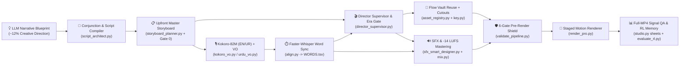

# 🎬 Stickman Hybrid — Machine-First 2D Documentary & Explainer Studio (`v4.2`)

[](#old-version-vs-v42-comparison)
[](https://www.python.org/)
[](https://ffmpeg.org/)
[](https://labs.google/flow)
[](#audio-storytelling--voiceover)
[](#youtube-monetization--copyright-purity-guarantee)

> **A 100% free, local, Machine-First 2D stickman documentary production engine (`9:16` Shorts + `16:9` Long)** featuring upfront Master Storyboard planning, word-locked choreography, staged Vox-style motion cards, a 113-asset bespoke Flow sticker vault, 100% local commercial-safe Urdu neural TTS, studio `-14 LUFS` audio mastering, and 6 pre-render Quality Gates.

---

## 🌟 Overview

**Stickman Hybrid (`v4.2`)** turns an approved documentary script into independent, zero-crop **`9:16` Vertical Shorts (`1080×1920`)** and **`16:9` Widescreen Master Documentaries (`1920×1080`)** with expressive 2D stickman art (`look: bright` warm vintage parchment), slow choreographed data graphics, curated bespoke Flow props, tactile Foley sound design, and automated signal QA.

### Machine-First Split (`~88% Local Engine / ~12% LLM`)

Every mechanical, mathematical, DSP, CV, validation, rendering, and QA step executes **100% locally in Python, NumPy, SciPy, Pillow, Kokoro-82M, Faster-Whisper, Tesseract OCR, and FFmpeg**, while the LLM focuses strictly on creative narrative ideation, factual accuracy, and scene prompts:



| Stage | Owner | Modules & Deterministic Capabilities |
| :--- | :--- | :--- |
| **Story, 6-Act Retention & Prompts** | **LLM** + Local Audit | Authored blueprint audited locally by `narrative_intelligence.py`, `curiosity_engine.py`, `viral_hook_engine.py`, and `viral_seo_intelligence.py`. |
| **Text Normalization & Gaps** | **100% Local** | `script_architect.py` normalizes telegraphic comma lists (`"sugar, coffee, soda"` $\to$ `"sugar, coffee, and soda"`) and sets twist/punctuation pauses. |
| **Master Storyboard Pre-Flight Lock** | **100% Local** | `storyboard_planner.py` compiles `STORYBOARD.md` & `STORYBOARD.json`, enforcing Gate 0 pre-spend validation (auditing card triggers, hold floors, unique shot budgets) before asset spend. |
| **TTS & Enumerated List Prosody** | **100% Local** | `kokoro_vo.py` (English) and `urdu_vo.py` (Urdu, Kokoro-82M + EspeakG2P) synthesize multi-item lists with natural `0.28s–0.40s` breathing rhythm, DC removal, and `12ms` fades; levels to `-14 LUFS`. |
| **Forced Word Alignment** | **100% Local** | `align.py` (`Faster-Whisper int8`) locks word timestamps (`WORDS.tsv`) for subtitles, spoken-word card triggers, sticker onsets, and cadence checks. |
| **Asset Search & Flow Keying** | **100% Local** (+ Flow) | `asset_registry.py` + `index_stickers.py` search `113` alpha-verified bespoke Flow cutouts with strict **`ban_modern` Era Filtering**; `key.py` + `cutout.py` key magenta backgrounds. |
| **Director Choreography** | **100% Local** | `director_supervisor.py` enforces **Exact Literal Noun Matching** (`w_raw == slug`), shot-size alternation, and `DIRECTOR_PLAN.json` staging. |
| **VFX & Audio Mastering** | **100% Local** | `vfx_smart_designer.py`, `sfx_smart_designer.py`, and `mix.py` apply `zoom_dissolve` / `slide_push` / `paper_crossfade`, trim silent music intros, duck beds, and master to `-14.0 LUFS`. |
| **Validation, Render & Signal QA** | **100% Local** | `validate_pipeline.py` runs 6 Pre-Render Gates (card voice-sync check, OCR leak `conf >= 65.0`, banned SFX block, Fact-Number Parity, `F_RUSHED_LIST`); `render_pro.py` & `evaluate_rl.py` verify MP4 signals. |

---

## 🔄 Old Version vs. `v4.2` Comparison

| Pillar | Previous Release (`v4.0`) | `v4.2` Machine-First Documentary Engine |
| :--- | :--- | :--- |
| **Production Planning** | Post-generation audit only (defects caught after Flow spend) | **Upfront Master Storyboard (`storyboard_planner.py`)** with `STORYBOARD.md` & `STORYBOARD.json` + **Gate 0 Pre-Flight Lock** (`studio.py storyboard <dir> --strict`) for 1st-shot accuracy |
| **Editorial Cards & Voice Sync** | Cards fired at sentence start (`line_t0`), causing 3–6s early desync and 1.0s half-faded cutaways | **Spoken Trigger Anchoring (`find_card_spoken_trigger()`)** locked to exact spoken numbers in `WORDS.tsv` (`card_t0 = spoken_t - 0.15s`), mid-line scene splitting, and readable floors (`>= 2.0s` stat / `>= 2.6s` compare) |
| **Sticker Quality & Vault** | 316 cutouts with low-quality internet icons (`cc0_library/`) and fuzzy quota-stuffing spam | **100% Bespoke Flow Vault (113 curated cutouts, 113/113 `alpha_ok=True`)**, low-quality CC0 internet icon pack purged, quota stuffing replaced by **exact literal noun matching** |
| **Arrow & Overlay Logic** | Automatic red arrows drawn between unrelated stickers on standard illustrated scenes | **Connecting ink arrows restricted strictly to dedicated cards** (`card_stat`, `scale_compare`, `split_compare`); ghost fallback stickers eliminated |
| **Character Style Lock** | Realistic cartoon humans (sailors, miners, scientists) drifted into Flow scenes | **Automatic inline role-noun rewriting** in `flow_prompt_auditor.py` enforcing `2D stickman [role] with pure-white round head and black stick limbs` |
| **Voiceover & Multilingual** | English local; Urdu required manual `VO.wav` placement or external Kaggle Parler-TTS | **100% Local Commercial-Safe Urdu TTS (`urdu_vo.py`)** on CPU via Kokoro-82M + EspeakG2P (RTF ~0.40, Apache-2.0, zero GPU/network dependencies, automatic Whisper `WORDS.tsv` alignment) |
| **Framing & Captions** | Hormozi kinetic captions stamped on both 16:9 and 9:16 | **16:9 Widescreen defaults to clean documentary view (`--no-captions`)**; 9:16 Shorts retain kinetic captions |
| **Sound Design Purity** | Occasional chime/countdown/reverse whoosh leaks | Expanded **`BANNED_SFX_KEYWORDS`** (`beep`, `beeps`, `countdown`, `reverse`, `screech`, `radio`, `glitch`, `buzz`) blocked in both designer and Gate 3 |
| **Quality Evaluation** | High RL scores occasionally masking sync drift | **Honest RL Quality Shield (`evaluate_rl.py`)**: `F_CARD_VOICE_DESYNC` and `F_STICKER_VOICE_DESYNC` deduct -20 pts, preventing false passes |

---

## 📦 Verified Asset Vault & 9 Synced Skills

All asset manifests are 100% reconciled (`0` missing files, `0` orphan files) and all **9 skills** are mirror-synced (`0 diff` across `skills/`, `~/.gemini/config/skills/`, and `~/.claude/skills/`):

* **Stickers ([stickman-stickers/CATALOG.tsv](skills/stickman-stickers/CATALOG.tsv)):** **`113`** transparent bespoke Flow cutouts (`113/113 alpha_ok=True`, static `.png` + animated `.webp`, clean literal metadata).
* **SFX & Music ([vox-doc-sound/CATALOG.tsv](skills/vox-doc-sound/CATALOG.tsv)):** **`1,654`** tracks (`1,582` CC0 Foley/Impacts/Tactile UI SFX + `72` music beds with non-silent `0.00s` onsets).
* **Backgrounds ([backgrounds/CATALOG.tsv](skills/stickman-hybrid/backgrounds/CATALOG.tsv)):** **`8`** editorial parchment, vintage grain, kraft, blueprint, and dark-outro textures.
* **VFX Overlays ([vfx_assets/CATALOG.tsv](skills/stickman-hybrid/vfx_assets/CATALOG.tsv)):** **`12`** CC0/MIT lighting, ink-arrow, ban-stamp, and animated paper-grain / sunlit-dust `.webp` layers.
* **Look Presets (`skills/stickman-hybrid/looks/`):** `bright` (canonical warm parchment), `warm`, `night`, `ink`, `oversimplified`, `cgp_grey`, `casually_explained`, `minute_physics`, `painted`.
* **9 Modular Skills (`skills/`):** `stickman-hybrid`, `stickman-stickers`, `vox-doc-sound`, `data-storytelling`, `emotional-arc-designer`, `headline-psychologist`, `loss-aversion-designer`, `visual-emotion-engineer`, `youtube-seo-optimizer`.

---

## 🚀 Quickstart & CLI Reference (`studio.py`)

### 1. Prerequisites & Setup
```bash
# Ubuntu / Debian FFmpeg (with libass + VA-API support)
sudo apt update && sudo apt install -y ffmpeg tesseract-ocr

# Python dependencies (Python 3.11+)
python3 -m pip install -r requirements.txt

# Verify zero-setup environment & catalogs
python3 studio.py doctor
```

### 2. `studio.py` Control Plane Commands

| Command | Purpose |
| :--- | :--- |
| `python3 studio.py doctor` | Audits Python packages, FFmpeg/VA-API, Kokoro (EN & UR), Whisper, fonts, catalogs, RL policy, and 6-Gate shield. |
| `python3 studio.py storyboard <dir> [--strict]` | Compiles `STORYBOARD.md` & `STORYBOARD.json` and runs Gate 0 pre-flight validation before asset spend. |
| `python3 studio.py create "<Topic>" --look bright` | Runs dual-pipeline project generation (`9:16` Short + `16:9` Master Documentary) in `~/StickmanHybrid/`. |
| `python3 studio.py voice --text "<Text>" --lang ur` | Generates 100% local commercial-safe neural voiceover for English or Urdu via Kokoro-82M on CPU. |
| `python3 studio.py director <project_dir>` | Runs Gate 0 choreography, literal/era sticker filtering, and outputs `DIRECTOR_PLAN.json`. |
| `python3 studio.py gate <project_dir> --format 9:16` | Enforces all 6 Pre-Render Quality Gates (`--format` accepts `9:16` or `16:9`). |
| `python3 studio.py stickers --search "bronze sword"` | Searches the 113-asset bespoke Flow sticker vault (or rebuilds `CATALOG.tsv` cleanly). |
| `python3 studio.py hook "<Topic>" --archetype modern_inversion` | Generates a standalone 3-second high-retention A-E-T hook test. |
| `python3 studio.py heading "Chapter 1" --subtitle "14,000 BP"` | Renders an animated chapter title card with Ken Burns drift. |
| `python3 studio.py page "50,000 MILES OF STONE" --pose think` | Generates a signature Ink Explainer plain-paper palate cleanser page. |
| `python3 studio.py sheets <video.mp4> --out qa/` | Extracts `hook_sheet.jpg`, `phone_sheet.jpg`, `beats_sheet.jpg` & signal scan (`blank_frame0`, `flash`, `freeze_2.5s`). |
| `python3 studio.py qc <project_dir>` | Runs post-render multi-rule Quality & RL Memory evaluation (`evaluate_rl.py`). |
| `python3 studio.py trends --niche ancient_engineering` | Researches high-RPM YouTube documentary topics and SEO clusters. |
| `python3 studio.py vfx input.mp4 --effect shake_impact` | Applies standalone signal/camera VFX filters to rendered video. |

---

## 📝 `v4.2` Release Highlights

* **Upfront Master Storyboard Planner:** Added `storyboard_planner.py` generating `STORYBOARD.md` and `STORYBOARD.json` with Gate 0 pre-spend validation (`studio.py storyboard <dir> --strict`), locking narrative structure, card sync, and shot budgets before asset spend.
* **Spoken-Trigger Card Synchronization:** Eliminated 3–6s early card desync via `find_card_spoken_trigger()` and mid-line scene splitting. Cards anchor strictly to spoken numbers in `WORDS.tsv` with readable duration floors (`>= 2.0s` stat / `>= 2.6s` compare).
* **Purge of Low-Quality Clip Art:** Removed external `cc0_library/` icon vectors; rebuilt `stickman-stickers/CATALOG.tsv` with **113/113 bespoke Flow cutouts** (`100% alpha_ok=True`) and exact literal noun matching.
* **100% Local Commercial-Safe Urdu TTS:** Built `urdu_vo.py` combining Kokoro-82M with `misaki.espeak.EspeakG2P(language="ur")` on CPU (RTF ~0.40, Apache-2.0, zero external network or Kaggle dependency), complete with broadcast vocal chain and Faster-Whisper alignment.
* **Inline Stickman Character Role Rewriting:** `flow_prompt_auditor.py` automatically rewrites 12 human roles (`sailors`, `miners`, `guards`, etc.) into `2D stickman [role] with pure-white round head and black stick limbs` to prevent realistic human style drift.
* **Clean 16:9 Cinema Documentary Default:** 16:9 widescreen documentaries default to `--no-captions` (clean cinematic visual), while 9:16 Shorts retain kinetic captions.
* **Honest RL Quality Shield:** Upgraded `evaluate_rl.py` to penalize desynced cards (`F_CARD_VOICE_DESYNC`) and desynced stickers (`F_STICKER_VOICE_DESYNC`), permanently killing false `100/100` scores.

---

## 📁 Repository Layout (`48` Active Scripts)

```text
stickman-animation/
├── studio.py                           # Unified CLI studio orchestrator & signal QA
├── auto_bootstrap.py                   # Zero-setup package & model self-provisioner
├── requirements.txt                    # Python dependency spec
├── AGENT_START_GUIDE.md / CLAUDE.md    # Orchestration & quality-gate manuals
└── skills/
    ├── stickman-hybrid/                # Core rendering, Director, VFX/SFX, 6-Gate shield & RL engine
    │   ├── looks/                      # 9 editorial look presets (bright.md canonical)
    │   ├── backgrounds/                # 8 indexed CC0 parchment/canvas textures
    │   ├── vfx_assets/                 # 12 indexed CC0/MIT overlays (.png + animated .webp)
    │   └── scripts/                    # render_pro.py, director_supervisor.py, validate_pipeline.py, ...
    ├── stickman-stickers/              # 113 bespoke Flow cutouts (flow_vault, 100% alpha_ok=True)
    ├── vox-doc-sound/                  # 1,654-track CC0 SFX/music library, Kokoro EN & UR TTS, Whisper & -14 LUFS mix
    └── [6 companion writing/SEO skills]# data-storytelling, emotional-arc-designer, headline-psychologist,
                                        # loss-aversion-designer, visual-emotion-engineer, youtube-seo-optimizer
```

---

## 💰 YouTube Monetization & Copyright Purity Guarantee

* **Original Scene Art:** All primary 2D stickman scenes (`shots/`) and Tier-1 cutouts (`flow_vault/`) are original project-generated artwork.
* **CC0 / MIT Prop & VFX Vault:** External icons, animated `.webp` props, music beds, and SFX are strictly verified **CC0-1.0 / Public Domain / MIT** and logged with source URLs across all `CATALOG.tsv` manifests.
* **Open-Weights Voice & Fonts:** Uses Apache 2.0 `Kokoro-82M` (`Faster-Whisper` MIT) and SIL Open Font License fonts (`PermanentMarker`, `Bangers`, `Caveat`, `SedgwickAve`, `PatrickHand`, `Montserrat`, `LuckiestGuy`, `Kalam`).
